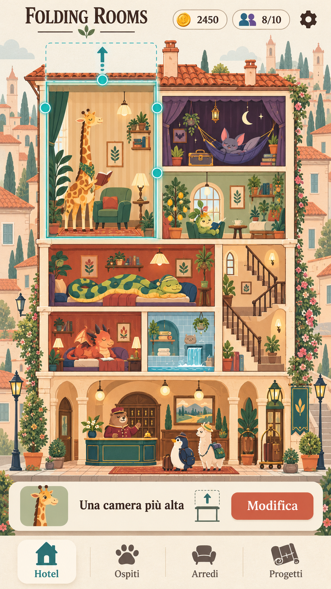

# Folding Rooms

**Titolo di lavoro scelto:** Folding Rooms  
**Nome precedente del concept:** Hotel Pieghevole  
**Stato:** progetto selezionato per lo sviluppo.  
**Piattaforma:** mobile, orientamento verticale.  
**Genere:** gestionale creativo di hotel con puzzle spaziali e ospiti caratteristici.  
**Versione:** 0.1 — 2 novembre 2026.  
**Cartella di progetto prevista:** `C:\Users\ricca\Documents\APP_4_Fun\Folding_Rooms`

> Costruisci un hotel che cambia forma per accogliere ospiti impossibili: tira una parete, allunga una camera e trasforma un problema di spazio in una piccola scena felice.

## 1. Identità del gioco

Il protagonista è l’hotel stesso: un edificio persistente, abitato da creature con esigenze riconoscibili. Il giocatore ne modifica camere e distribuzione dello spazio trascinando pareti e solai. Una giraffa vuole una stanza alta, un serpente uno spazio basso e lungo, un pipistrello un angolo buio, un ospite vegetale luce naturale.

La promessa è far sentire il giocatore un albergatore ingegnoso. L’edificio cresce perché impara ad accogliere ospiti diversi e a far convivere i loro bisogni.

“Pieghevole” descrive per ora la trasformazione elastica delle camere. Non è stata scelta una simulazione di origami o di piegatura fisica dell’intero edificio.

## 2. Il gesto che deve convincere

Tocchi una camera e compaiono maniglie grandi sulle pareti modificabili. Trascinando verso l’alto, la stanza si allunga, gli arredi si riadattano e una sagoma dell’ospite mostra se lo spazio è sufficiente. Al rilascio la camera si assesta con un’animazione morbida. La giraffa entra, finalmente raddrizza il collo e sistema la valigia.

Il piacere deve già esistere in questa interazione, prima di negozi, valute e progressione.

**Regola proposta per il primo prototipo:** geometria su griglia, camere rettangolari e modifiche dentro un involucro disponibile. Trascinare un confine può usare spazio libero; se coinvolge una stanza occupata adiacente, l’anteprima mostra entrambe le modifiche. Il gioco rifiuta una trasformazione che renda una camera inutilizzabile. Nessuna stanza viene cancellata automaticamente.

La deformazione visiva è elastica; le regole sottostanti rimangono discrete e leggibili. Questa soluzione tecnica è una proposta da verificare, non un vincolo già approvato.

## 3. Primi minuti

1. Apri una pensione piccola con due camere e una reception.
2. Accogli un ospite semplice per capire selezione e assegnazione.
3. Arriva una giraffa: l’icona dell’altezza mostra che non entra.
4. Trascini il soffitto nello spazio libero disponibile e confermi.
5. L’ospite entra e la camera si anima; ricevi il primo compenso.
6. Un serpente introduce una diversa forma ideale e una scelta di distribuzione.
7. Scegli un arredo o una prima espansione e vedi un nuovo ospite in arrivo.

All’inizio ogni ospite introduce un solo bisogno. Le combinazioni ambientali entrano dopo che il gesto di modifica è chiaro.

## 4. Ciclo di gioco

Osserva gli ospiti → scegli chi ospitare → adatta camere e vicinanze → accogli → osserva la vita dell’hotel → incassa e raccogli ricordi → amplia o riorganizza → affronta nuove esigenze.

Il gestionale deve lasciare spazio alla composizione. Gli ospiti sono persone del mondo di gioco, non semplici ordini da smaltire. Le loro reazioni, gli oggetti personali e le visite successive rendono memorabili le camere.

## 5. Ospiti ed esigenze

| Ospite guida | Bisogno leggibile | Risposta del giocatore |
|---|---|---|
| Giraffa | Altezza | Allungare la camera verso l’alto |
| Serpente | Lunghezza | Creare una stanza bassa e distesa |
| Pipistrello | Buio | Sistemare una stanza schermata o interna |
| Ospite vegetale | Luce naturale | Dare accesso a una parete esterna luminosa |
| Draghetto | Calore | Organizzare una zona calda utile ai servizi vicini |
| Ospite acquatico | Umidità | Collegare la sua presenza a spazi adatti |

Le ultime due specie introducono interazioni: un draghetto può scaldare la piscina, una zona umida favorire la serra. L’effetto deve essere visibile e spiegato da un’icona di anteprima, senza richiedere di indovinare una formula nascosta.

Nel prototipo si verifica prima una sola sinergia. Le specie, le compatibilità precise e gli eventuali conflitti devono essere definite dopo aver provato il nucleo spaziale.

## 6. Camere, arredi e oggetti

- **Camere:** spazio modificabile, assegnazione ospite, stato dei bisogni.
- **Arredi funzionali:** letti adattabili, tende oscuranti, lampade, vasche e piante; pochi effetti espliciti.
- **Servizi comuni:** reception, piscina, serra e terrazza, introdotti gradualmente.
- **Ricordi degli ospiti:** cartoline, valigie, piccoli regali e oggetti esposti che raccontano la storia dell’hotel.
- **Decorazioni:** palette, carte da parati, facciate e dettagli che permettono uno stile personale.

Non ogni oggetto deve influire sui bisogni. Separare chiaramente funzione e decorazione evita che il giocatore debba rinunciare all’estetica che preferisce per una combinazione numericamente migliore.

## 7. Progressione delle cose da fare

**Pensione iniziale.** Accogliere le prime specie, imparare altezza e larghezza, arredare e riconoscere i visitatori abituali.

**Hotel verticale.** Aprire nuovi piani, distribuire lo spazio tra camere diverse e riorganizzare il vecchio edificio quando arriva una nuova esigenza.

**Ambientazioni e servizi.** Introdurre luce, buio e un primo spazio comune. Sperimentare la prima coppia di ospiti o servizi che si aiuta grazie alla vicinanza.

**Terrazze e ali specializzate.** Creare un’ala luminosa, un piano tranquillo o una zona acquatica. Le scelte devono produrre hotel diversi, non una sola disposizione obbligatoria.

**Grande progetto finale — proposta.** Preparare una festa di riapertura o un incontro di ospiti già conosciuti, mostrando quanto l’hotel sia diventato capace di accoglierli insieme. Usare le meccaniche apprese, senza introdurre all’ultimo una nuova regola.

**Dopo la campagna.** Continuare a personalizzare, cercare ricordi e affrontare gruppi di ospiti con richieste differenti. Struttura del finale e contenuti successivi restano proposte da valutare.

## 8. Perché tornare

Tre motivazioni sostengono il concept: la soddisfazione del gesto, il desiderio di completare il proprio hotel e la curiosità per nuovi ospiti e interazioni. I ritorni degli ospiti possono portare piccoli cambiamenti narrativi o ricordi.

Ogni visita al gioco dovrebbe permettere una modifica significativa, anche breve. Le nuove attività devono aggiungere decisioni spaziali e carattere, non soltanto attese più lunghe. La durata delle sessioni e la capacità di trattenere i giocatori non sono ancora misurate.

## 9. Direzione artistica e interfaccia

Hotel visto frontalmente in sezione, leggibile come una casa delle bambole. Forme morbide, camere dai colori distinti, ospiti espressivi, palette crema, terracotta e menta. Le animazioni raccontano il rapporto tra ospite e spazio: collo che si distende, serpente che si accomoda, pipistrello che si appende.

La schermata principale mostra l’edificio. In alto poche informazioni gestionali; in basso navigazione tra Hotel, Ospiti, Arredi e Progetti. Selezionando una stanza compaiono gli strumenti pertinenti. Un incarico attivo può essere visibile in una scheda compatta.

Durante un trascinamento contano soltanto contorno, maniglia, bisogno dell’ospite e risultato previsto. Gli elementi decorativi non devono coprire le pareti selezionabili.

L’immagine è un riferimento artistico preliminare, creato con il nome precedente “Hotel Pieghevole”. Numeri, testo e layout non sono specifiche finali; il titolo del progetto è ora Folding Rooms.

## 10. Differenziazione

La firma proposta è un hotel persistente e deformabile dove la forma delle camere serve ospiti riconoscibili e le vicinanze generano piccole interazioni ambientali.

Esistono già giochi di hotel e puzzle di suddivisione delle stanze; Tiny Hotel Shikaku è un riferimento individuato nella ricerca preliminare. Folding Rooms deve essere riconoscibile attraverso la trasformazione diretta dell’edificio, la vita degli ospiti e la continuità della costruzione. Non si rivendica l’esclusività di ogni singola meccanica.

## 11. Primo prototipo da costruire

Perimetro proposto: un edificio piccolo, poche camere, tre ospiti con esigenze geometriche, trascinamento delle pareti, anteprima valida/non valida, assegnazione e reazione dell’ospite, salvataggio della disposizione. Aggiungere una singola interazione ambientale soltanto dopo che modificare le camere è piacevole.

Domande da verificare osservando giocatori:

- Capiscono dove trascinare senza una spiegazione lunga?
- Comprendono perché una modifica è possibile o bloccata?
- Provano spontaneamente un’altra sistemazione?
- Sentono che l’hotel è loro e riconoscono gli ospiti?
- Riescono a modificare una stanza con precisione su uno schermo piccolo?

## 12. Decisioni ancora aperte

Engine, architettura, dimensioni della griglia, libertà delle forme, gestione di accessi e corridoi, numero di specie, economia, monetizzazione, salvataggi remoti e finale non sono ancora stati scelti. Il concept non autorizza a considerarli requisiti definitivi.

Priorità di sviluppo: rendere divertente e leggibile la trasformazione di una camera, poi costruire attorno a quel gesto la progressione dell’hotel.
