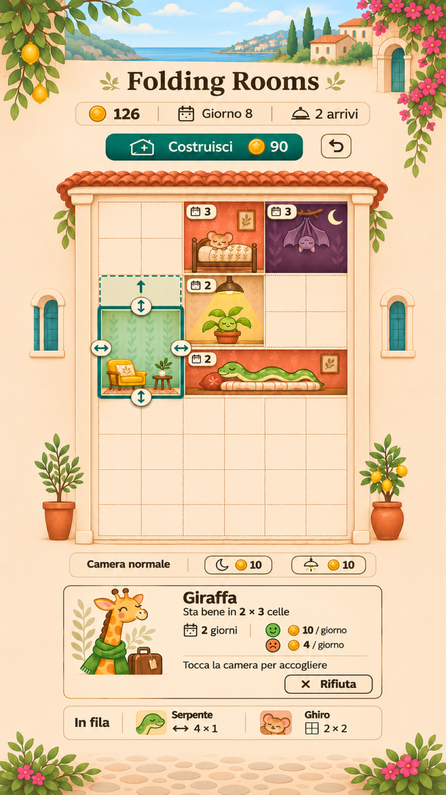

# Folding Rooms — proposta di stile per la schermata principale

**Data:** 2026-11-04. **Autore:** Codex (GPT-6).
**Stato:** proposta da valutare; non ancora applicata alle scene Godot.
**Formato scelto da Riccardo:** 9:16 verticale. Riferimento logico del progetto: 720×1280 pixel. Immagine della proposta: 1152×2048 pixel, rapporto esatto 9:16.
**Godot del progetto:** 4.7.2-stable; nessuna modifica a script, scene o impostazioni.

## 1. Direzione consigliata

Un piccolo hotel mediterraneo illustrato, con intonaco crema, tegole di terracotta, verde delle piante e ospiti espressivi. Il disegno ricorda un libro illustrato: forme semplici, materiali opachi, ombre leggere e dettagli selezionati. L'edificio resta una sezione frontale, senza prospettiva inclinata, perché i lati delle camere devono coincidere con quelli della griglia.

La firma del gioco è la camera che cambia forma. Cornice selezionata, maniglie e risultato previsto devono emergere prima di piante, mobili e facciata. Il riferimento precedente del concept rimane conservato: questa è una nuova proposta per l'interfaccia effettivamente presente nel prototipo.

## 2. Palette proposta

I codici indicano i colori di partenza per l'implementazione; l'illustrazione generata contiene variazioni di luce e non ne è un campionario esatto.

| Nome | Codice | Uso |
|---|---|---|
| Crema | `#F5EDDD` | Sfondo generale, intonaco |
| Avorio | `#FFF9EE` | Schede, superfici dei pulsanti, maniglie |
| Inchiostro | `#342F2A` | Testi, numeri, simboli |
| Petrolio | `#245D56` | Selezione, azioni principali, frecce |
| Menta | `#BED5C2` | Una famiglia di carte da parati |
| Terracotta | `#C46D50` | Tetto, altra famiglia di camere, accenti |
| Miele | `#D8A348` | Monete, lampade e piccoli arredi |
| Prugna | `#383044` | Interni delle camere buie |

Il colore della carta da parati non indica se una camera è valida. Una camera selezionata ha un contorno e maniglie; un risultato valido ha anche una spunta, uno rifiutato una croce. Comfort e disagio hanno faccine diverse, oltre al colore.

## 3. Composizione della schermata

1. **In alto:** titolo compatto, monete, giornata e arrivi rimasti. Costruisci mostra il prezzo reale accanto alla moneta. Il comando per ricominciare rimane separato e secondario, conservando la conferma di D-031.
2. **Al centro:** involucro modificabile di 6×8 celle quadrate, come D-010. Le aree vuote hanno un motivo discreto; le camere sono rettangoli dai bordi netti. Nessun corridoio aggiunto: D-020 continua a valere.
3. **Sotto l'edificio:** strumenti della luce della camera selezionata. Il pannello compare solo quando serve e non copre il campo di gioco.
4. **In basso:** scheda grande dell'ospite di turno e due ritratti più piccoli della fila, con il relativo bisogno. Nessuna distinzione inventata tra chi arriva oggi e domani.

L'immagine presenta lo stile, non coordinate da copiare. Nell'interfaccia reale la griglia va calcolata con celle quadrate: i segmenti disegnati dal generatore sono approssimativi. La camera menta e l'estensione tratteggiata raccontano il gesto; non rappresentano un salvataggio da ricostruire cella per cella.

La scena illustrata occupa più spazio decorativo di quanto sia consigliabile nella versione giocabile: durante l'implementazione ridurre panorama, titolo e margini laterali prima di ridurre il campo di gioco o i comandi. Sul riferimento 720×1280 vanno verificati insieme griglia, maniglie e scheda ospite. Le misure delle aree sensibili già approvate non cambiano con questa proposta.

Su telefoni più lunghi il disegno può continuare oltre il riferimento 9:16, usando il comportamento di espansione già configurato nel progetto. I comandi restano dentro l'area sicura, cioè lo spazio libero dalla fotocamera e dalle barre di sistema. Non fissare margini identici per tutti gli iPhone.

## 4. Camere modulari, senza stiramenti

Seguire D-018: una camera è composta da elementi indipendenti.

- **Carta da parati:** motivo ripetibile, con pochi segni grandi e contrasto basso. Allargando la camera compaiono altre ripetizioni.
- **Cornici, battiscopa e pavimento:** fasce di spessore costante, ritagliate sul contorno della camera. Non allungare decorazioni o venature insieme alla parete.
- **Arredi:** misura costante e posizione riferita a un lato. Due o tre oggetti leggibili per camera; quelli facoltativi compaiono soltanto quando rimane spazio.
- **Ospite:** sagoma espressiva contenuta nella camera. Collo della giraffa e corpo del serpente devono raccontare il rapporto con lo spazio; il viso rimane libero.
- **Distintivi:** permanenza in un angolo, luce nell'altro. Non devono coprire ospiti, maniglie o guadagni.

Nelle camere da 1×1 cella togliere prima gli arredi facoltativi e i motivi minuti. Gli ospiti non devono sconfinare nelle camere superiori. La variante buia mantiene visibili il viso, i simboli e i guadagni; l'illuminazione speciale è riconoscibile dalla lampada e dal suo simbolo. La posizione nell'edificio non determina la luce, come stabilito in D-032.

## 5. Selezione e trascinamento

**Camera selezionata:** bordo petrolio continuo e quattro maniglie avorio con frecce lungo l'asse giusto. Le maniglie hanno un disegno semplice, diverso dagli arredi. L'area che riceve il tocco resta più grande della forma visibile, secondo D-030.

**Durante il gesto:** mostrare contorno previsto, griglia utile, sagoma dell'ospite e simbolo del risultato. Le icone dell'esito stanno sopra il dito. Gli strumenti non pertinenti perdono evidenza. Un eventuale bordo della camera vicina coinvolta rimane distinguibile.

**Al rilascio:** mantenere la risposta elastica già presente. Lo stile non autorizza cambi a durata, regole o misure del gesto approvate. Il disegno di un arredo non può decidere se una modifica è valida.

## 6. Schede e pulsanti

La scheda dell'ospite espone, in ordine: ritratto e specie; misura per stare bene; giorni di permanenza; compenso da comodo e da scomodo. I valori provengono dall'ospite estratto, senza numeri fissi nella grafica. Le misure di ingresso restano distinte da quelle di comfort.

L'istruzione è «Tocca la camera per accogliere», coerente con il gesto esistente. Rifiuta è un pulsante secondario con croce e testo, separato dai valori. Nessun nuovo pulsante Accogli e nessuna assegnazione tramite trascinamento del ritratto.

Costruisci è un pulsante pieno petrolio con simbolo camera e prezzo. Se non si può comprare, il suo aspetto lo comunica senza perdere leggibilità. Nella modalità costruzione i segni «+» appartengono alle celle disponibili, non alle decorazioni.

Il pannello luce dell'immagine mostra soltanto il caso di una camera normale. Nell'app deve rappresentare anche ritorno immediato a normale per 20 monete, ritorno gratuito con lavori e durata dei lavori, secondo D-032. Conservare la conferma del reset esistente; l'icona a freccia curva dell'illustrazione non introduce una funzione Annulla.

## 7. Testi e simboli

Titolo con carattere graziato morbido, cioè lettere con piccoli tratti terminali. Testi funzionali con carattere senza grazie, semplice e leggibile. Nessun carattere esterno è stato scelto o installato: font e licenze vanno definiti prima dell'integrazione.

Sul riferimento largo 720 pixel, partire da 32 pixel per le informazioni principali, 28 pixel per quelle secondarie e 40 pixel per i valori più evidenti. Sono misure proposte da provare sul telefono. Il testo deve potersi disporre su più righe senza ridurre troppo le lettere. Tutti i testi dell'app passeranno da `tr()` e dalle traduzioni.

Simboli con forme piene e pochi dettagli: moneta per denaro, calendario per giornate, campanello per arrivi, luna per buio, lampada per illuminazione speciale, freccia verticale/orizzontale per altezza/larghezza. Non assegnare bisogni di luce a serpente o ghiro. Nessun simbolo ambiguo senza una spiegazione nel contesto.

Le aree sensibili devono rispettare almeno 48 dp su Android e 44 pt su iOS, come richiesto da AGENTS.md. Queste sono unità dell'interfaccia del telefono: i pixel dell'immagine non dimostrano da soli che un pulsante sia abbastanza grande.

## 8. Verifiche e prossimo passo

**Eseguito:** lettura di concept, decisioni e interfaccia attuale; generazione e rifinitura con image_gen integrato; controllo visivo di testi e componenti; esportazione PNG 1152×2048 e verifica del rapporto esatto 9:16. Il file restituito dall'ultima generazione misurava 941×1672 pixel; l'esportazione ha normalizzato il minimo arrotondamento delle proporzioni.

**Non eseguito:** applicazione dello stile in Godot, prova della nuova interfaccia sul telefono, verifica del contrasto numerico, animazioni o misure di prestazioni. Nessun test del gioco rieseguito: nessun codice o regola modificati.

**Prossimo passo proposto:** dopo il giudizio di Riccardo, applicare lo stile a una sola camera e alla scheda ospite. Poi provare su iPhone una camera 1×1, una giraffa 2×3, un serpente 4×1, due camere adiacenti e una stanza buia. Durante ogni gesto controllare che il dito lasci visibili esito e bisogno, che il centro della camera sia afferrabile e che i testi restino leggibili. Non dichiarare completata la guida approvata della fase 8 prima del giudizio di Riccardo.

Prompt completi: [STILE_PROMPT.md](STILE_PROMPT.md). Fonte dell'immagine: [CREDITI.md](CREDITI.md).
